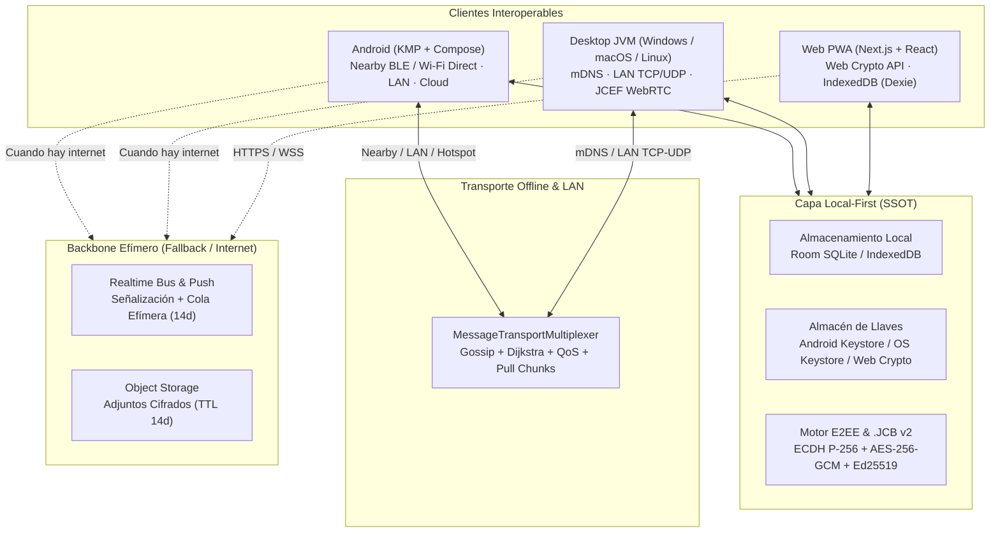

# Relay

**Mensajería Local-First, cifrada de extremo a extremo (E2EE) y con red Mesh offline — sin número de teléfono, sin tarjeta SIM y sin depender de servidores centrales.**

**Relay** es un ecosistema de comunicación multiplataforma compuesto por clientes nativos en **Kotlin Multiplatform + Compose Multiplatform** (Android, Windows, macOS, Linux) y una **PWA Web** ([chat.josepe.dev](https://chat.josepe.dev)) totalmente interoperables entre sí.

> [!NOTE]
> Este repositorio aloja la **documentación técnica pública**, el **seguimiento de incidencias** y los **binarios firmados oficiales** de Relay. El código fuente completo de la aplicación y la infraestructura backend se mantiene en repositorios privados mientras se extraen módulos standalone auditables.

---

## Capacidades principales

- **Local-First como fuente de verdad:** Tu historial vive cifrado y almacenado localmente en tu dispositivo (Room SQLite en KMP, IndexedDB en Web). La nube actúa únicamente como buzón efímero de tránsito (retención de 14 días para chats privados y grupos) sin borrar tu historial local.
- **Cifrado de Extremo a Extremo (E2EE) interoperable:** Intercambio de claves **ECDH P-256** y cifrado autenticado **AES-256-GCM** con paridad bit-a-bit entre Android, Desktop JVM y Web Crypto API.
- **Identidad soberana y respaldo `.JCB` v2:** Sin número telefónico ni SIM. Puedes operar en modo **Solo Mesh**, invitado anónimo o vincular múltiples cuentas aisladas; exportar identidad y chats en un archivo `.jcb` cifrado (PBKDF2 + AES-GCM) o usar **Passkeys (WebAuthn)** y respaldo opcional en Google Drive.
- **Red Mesh Offline + LAN híbrida:**
  - **Proximidad sin internet (Android):** Descubrimiento y salto automático (*Bandwidth Upgrade*) de Bluetooth Low Energy a Wi-Fi Direct / Local Hotspot mediante Nearby Connections.
  - **Red local (Android ↔ Desktop):** Descubrimiento por mDNS/NSD y sockets TCP/UDP (incluido soporte completo cuando un teléfono actúa como **Mobile Hotspot / SoftAP** sin router ni internet).
  - **Enrutamiento multi-salto:** Dijkstra ponderado por costo físico de enlace + difusión **Gossip** con abanico controlado, TTL estricto y caché LRU anti-tormentas.
  - **Transferencia bajo demanda (*Pull*) y QoS:** Archivos fragmentados en bloques de 32–64 KB con verificación SHA-256 por bloque, prioridad estricta para texto/señalización, cuota diaria configurable y **Battery Guardian**.
- **Llamadas, Videollamadas y Walkie-Talkie:**
  - **Nube:** Voz, video HD multicámara y pantalla compartida con señalización en tiempo real.
  - **LAN offline (WebRTC P2P):** Audio, video HD y pantalla compartida directo en subred local (cero STUN/TURN).
  - **Mesh offline (Opus):** Llamadas de voz 1-a-1 y notas Walkie-Talkie (PTT) sobre Wi-Fi Direct / BLE.
- **Core (Asistente IA Local-First):** Segundo cerebro visual en grafo 2D con RAG sobre tu memoria y chats locales descifrados en el dispositivo, modo Live de voz/cámara, skills portables y soporte BYOK (*Bring Your Own Key*) para modelos Gemini/Gemma.

---

## Arquitectura del ecosistema

---

## Descargas

Todas las compilaciones oficiales firmadas (incluyendo auto-actualizaciones in-app) se publican en **[Releases](https://github.com/Josepe-Dev/Relay/releases/latest)**.

| Plataforma | Formatos disponibles | Notas |
|---|---|---|
| **Android** (API 26+) | `relay-android-arm64-v8a-*.apk` `relay-android-armeabi-v7a-*.apk` `relay-android-x86_64-*.apk` `relay-android-all-*.apk` | Recomendado `arm64-v8a` para teléfonos modernos. Si instalas `-all` (universal), el actualizador interno ofrece descargar después la variante optimizada para tu CPU. |
| **Windows** | `relay-windows-*.msi` / `.msix` | Instalador nativo JVM x64. |
| **Linux** | `relay-linux-*.deb` / `.AppImage` | Paquete Debian/Ubuntu/Zorin y binario portable AppImage. |
| **macOS** | `relay-macos-*.dmg` | Imagen de disco para macOS. |
| **Web PWA** | [chat.josepe.dev](https://chat.josepe.dev) | Instalable desde navegador con soporte offline parcial y Web Crypto nativo. |

> [!TIP]
> **Sobre los archivos `josepe-chat-*` en los releases:** Relay nació originalmente bajo el nombre *Josepe Chat*. Algunos releases conservan ambos prefijos (`relay-*` y `josepe-chat-*`) para mantener compatibilidad con el auto-actualizador de versiones anteriores. El contenido del binario es idéntico.

---

## Documentación técnica

- [**Arquitectura KMP & Local-First**](./docs/architecture.md) — Flujo unidireccional de datos (UDF), SSOT local, inyección de dependencias con Koin y retención efímera de 14 días.
- [**Cifrado E2EE y formato `.JCB` v2**](./docs/e2ee-and-jcb.md) — Derivación de llaves ECDH P-256, cifrado AES-256-GCM e interoperabilidad Kotlin ↔ TypeScript.
- [**Red Mesh Offline y Transporte**](./docs/mesh-network.md) — Multiplexor de transporte, Bandwidth Upgrade (BWU), detección por interfaces de kernel + RTT, Dijkstra + Gossip, transferencias *Pull* y Battery Guardian.
- [**Llamadas, Videollamadas y WebRTC**](./docs/calls-and-webrtc.md) — Contrato `CallManager`, WebRTC en LAN sin STUN/TURN, soporte de Mobile Hotspot (SoftAP), llamadas Opus por Nearby y estabilidad JCEF/Android.
- [**Seguridad y reporte de vulnerabilidades**](./SECURITY.md) — Cómo reportar fallos de seguridad de forma responsable.
- [**Módulo KMP `:packages:mesh-core`**](./packages/mesh-core) — Implementación Kotlin Multiplatform pura del motor de enrutamiento Mesh (Dijkstra ponderado, Split-Horizon Gossip, planificador QoS de dos colas, transferencias *Pull-Based* con SHA-256 y cuotas) con suite de tests en `commonTest`.

---

## Stack tecnológico (resumen)

| Capa | Android / Desktop (KMP) | Web PWA |
|---|---|---|
| **Lenguaje / Runtime** | Kotlin `2.1.10`, Coroutines, StateFlow | TypeScript `5`, Next.js `16`, React `19` |
| **UI** | Compose Multiplatform `1.8`, Material 3, Haze | Tailwind CSS `4`, Serwist PWA |
| **Persistencia Local** | Room KMP `2.7` (SQLite), DataStore | Dexie `4` (IndexedDB) |
| **DI & Red** | Koin `4`, Ktor `3`, jMDNS | Fetch / WebSockets |
| **Criptografía** | JCA / Android Keystore (ECDH P-256, AES-GCM, Ed25519) | Web Crypto API |
| **RTC / Audio** | Agora SDK, `stream-webrtc-android`, Concentus (Opus), JCEF | Agora RTC Web SDK, WebRTC |

---

## Contacto y enlaces

- **Web App:** [chat.josepe.dev](https://chat.josepe.dev)
- **Portfolio del autor:** [josepe.dev](https://www.josepe.dev)
- **Issues / Feedback:** [GitHub Issues](https://github.com/Josepe-Dev/Relay/issues)
