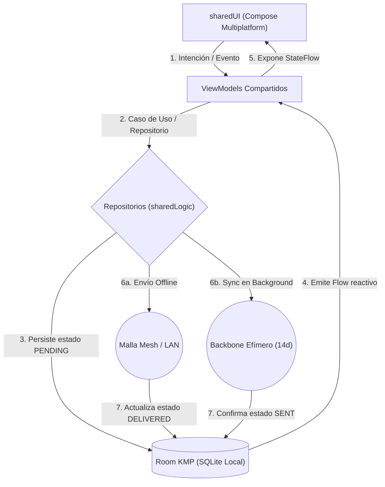

# Arquitectura KMP y Patrón Local-First

Este documento describe los principios arquitectónicos que gobiernan los clientes nativos de **Relay** en **Kotlin Multiplatform (Android, Windows, macOS, Linux)** y su sincronización con la **Web PWA**.

---

## 1. Flujo Unidireccional de Datos (UDF) y SSOT

Relay sigue un patrón estricto **Local-First**: la base de datos local (Room KMP en SQLite para nativo; IndexedDB/Dexie en Web) es la **única fuente de verdad (Single Source of Truth — SSOT)**. La capa de interfaz (`sharedUI`) nunca lee ni renderiza directamente respuestas de red.



### Garantías del flujo
- **Respuesta instantánea:** Enviar un mensaje o modificar un estado local persiste primero en SQLite, actualizando la UI al instante aunque no haya conexión.
- **Resiliencia ante reconexión:** Un mensaje creado sin red permanece en cola (`PENDING`) y se despacha vía Mesh si hay pares cercanos o hacia la nube cuando regresa la conectividad.
- **Independencia de transporte:** Para la UI es transparente si un mensaje llegó por Bluetooth LE, Wi-Fi Direct, socket LAN o sincronización en la nube.

---

## 2. Estructura modular en Kotlin Multiplatform

El cliente nativo separa la lógica pura de negocio de los adaptadores de sistema operativo mediante inversión de dependencias con **Koin**:

```text
relay-kmp/
 ├─ sharedLogic/         # Lógica compartida (commonMain + platform targets)
 │   ├─ commonMain/      # Dominio, Crypto E2EE, Mesh Router, Room DB, Repositorios, DI
 │   ├─ androidMain/     # Nearby Connections, Keystore, AudioPipeline, WebRTC, WorkManager
 │   ├─ jvmMain/         # mDNS (jMDNS), LAN Sockets, Desktop Keystore, JCEF WebRTC
 │   └─ iosMain/         # Adaptadores nativos iOS (WIP)
 │
 ├─ sharedUI/            # UI compartida en Compose Multiplatform (M3 + Haze)
 ├─ androidApp/          # Entry point Android (Activities, Foreground Services, FCM)
 └─ desktopApp/          # Entry point Desktop JVM (Ventana multi-panel, Hotkeys globales)
```

### Principios de diseño aplicados
- **Inversión de dependencias:** Los servicios de hardware y plataforma se definen como interfaces en `commonMain` y se enlazan mediante módulos Koin por plataforma (`androidMain`, `jvmMain`, `iosMain`), reservando `expect/actual` únicamente para constructores de bajo nivel.
- **Aislamiento multi-cuenta:** Cada cuenta iniciada (Google, Email, Invitado o *Solo Mesh*) aísla su propia instancia de base de datos local, preferencias y almacén de claves criptográficas cifradas (`SecureKeyStore` sobre Android Keystore o AES-GCM local en JVM).
- **Cierre determinista de hardware:** Los controladores de audio, cámara y streams implementan `AutoCloseable` y se liberan determinísticamente al cerrarse el ciclo de vida del `ViewModel` o servicio.

---

## 3. Retención efímera en la nube (14 días) vs. Invariante Local-First

Para minimizar la huella de datos almacenados en servidores externos sin sacrificar el historial del usuario:

1. **Purga automática en servidor (TTL 14 días):** Los mensajes privados y de grupo se eliminan físicamente del almacenamiento transitorio en la nube y de los adjuntos cifrados después de **14 días**. Los canales públicos comunitarios quedan exentos para preservar anuncios e hilos.
2. **Distinción entre purga efímera y borrado explícito:**
   - Cuando un usuario ejecuta *"Eliminar para todos"*, se propaga una mutación explícita que limpia el contenido en todos los dispositivos conectados.
   - Cuando el servidor ejecuta la purga automática de 14 días (`DELETE` físico en el bus Realtime), los clientes KMP **preservan íntegro el historial local en Room**, manteniendo las conversaciones consultables offline en el dispositivo.
3. **Degradación tras expiración:** Una vez superada la ventana de 14 días en servidor, se desactivan las mutaciones remotas sobre ese mensaje (edición o eliminación remota), permaneciendo disponibles el **borrado local** (*"Eliminar de este dispositivo"*) y la exportación de respaldo cifrado **`.JCB`**.
