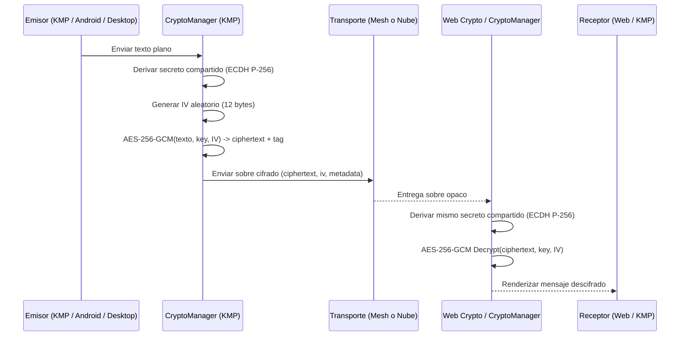

# Especificación de Cifrado E2EE y Formato `.JCB` v2

Este documento describe el modelo criptográfico de **Relay** para garantizar confidencialidad de extremo a extremo (E2EE) e interoperabilidad total entre los clientes **Kotlin Multiplatform** (Android / Desktop) y la **Web PWA** (TypeScript + Web Crypto API).

---

## 1. Modelo de Cifrado E2EE (Chats 1-a-1 y Grupos)

### Primitivas estándar
- **Acuerdo de claves (1-a-1):** **ECDH** sobre la curva elíptica **NIST P-256 (`secp256r1`)**.
- **Cifrado simétrico autenticado:** **AES-256-GCM** con nonce (IV) aleatorio de **12 bytes (96 bits)** por mensaje y tag de autenticación de **128 bits**.
- **Firma de identidad (Canal Público Mesh / Reportes verificables):** **Ed25519** / **ECDSA P-256 (`SHA256withECDSA`)**.
- **Codificación de transporte:** Base64 estándar sin saltos de línea (`NO_WRAP`).

### Flujo de cifrado y descifrado entre plataformas



### Cifrado en Grupos
Los grupos utilizan una clave simétrica de grupo (**Group Key** AES-256) generada localmente y distribuida a cada miembro de forma individual mediante **Key Wrapping** cifrado con el secreto compartido ECDH P-256 entre administrador y participante. Al rotar o agregar miembros, la distribución se realiza exclusivamente punto a punto sin exponer la clave del grupo en texto plano al servidor.

---

## 2. Almacenamiento seguro de claves privadas

- **Android:** Las claves privadas de identidad (formato PKCS#8) y secretos de sesión se cifran en reposo mediante **Android Keystore** respaldado por hardware (TEE / StrongBox cuando está disponible) a través de `SecureKeyStore`.
- **Desktop JVM:** Las claves y tokens de sesión se cifran en reposo con AES-GCM derivado mediante el almacenamiento seguro local aislado por UID de cuenta.
- **Web PWA:** Las claves se manejan como `CryptoKey` dentro de **IndexedDB** mediante la Web Crypto API del navegador.

---

## 3. Especificación del formato `.JCB` v2 (Relay Backup)

El archivo **`.jcb`** permite portar la identidad criptográfica (clave privada PKCS#8) y el historial local completo de mensajes entre dispositivos (Android, Desktop y Web) **sin que ningún servidor tenga acceso a las claves ni al historial en claro**.

### Derivación de clave maestra (`PinKey`)
Para exportar o importar un respaldo manual:
1. Se genera un **`salt`** criptográfico aleatorio de **32 bytes**.
2. Se deriva la `PinKey` (256 bits) a partir del PIN/secreto del usuario y el `salt` mediante **PBKDF2-HMAC-SHA256** (o Argon2id según perfil).
3. También es posible derivar o envolver el secreto de respaldo mediante **Passkeys (WebAuthn)** para respaldos sin PIN memorizado (*zero-PIN*) sincronizados opcionalmente con Google Drive en el espacio privado de la app.

### Estructura JSON del archivo `.JCB` v2

```json
{
  "version": 2,
  "uid": "user_identifier",
  "username": "handle",
  "ciphertext": "BASE64(AES_GCM_ENCRYPT(PrivateKey_PKCS8, PinKey))",
  "iv": "BASE64(12_BYTES_NONCE)",
  "salt": "BASE64(32_BYTES_SALT)",
  "history": {
    "ciphertext": "BASE64(AES_GCM_ENCRYPT(JSON(JCBHistory), PinKey))",
    "iv": "BASE64(12_BYTES_NONCE)"
  }
}
```

### Garantías del formato
- **Integridad autenticada:** Si el PIN es incorrecto o el archivo fue alterado, la verificación del tag GCM falla antes de hidratar cualquier dato en `SecureKeyStore` o Room.
- **Portabilidad total:** Un respaldo `.jcb` exportado en la Web PWA puede importarse directamente en Android o Desktop JVM (y viceversa), reconstruyendo la clave privada y la base de datos local completa.
