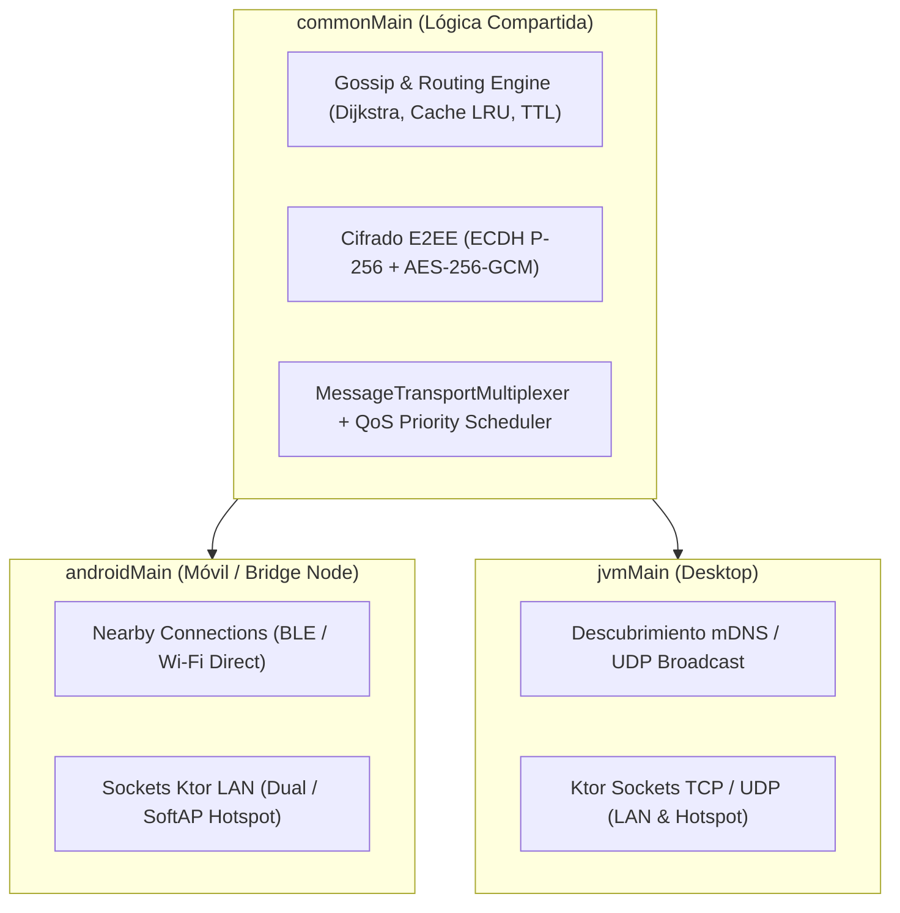
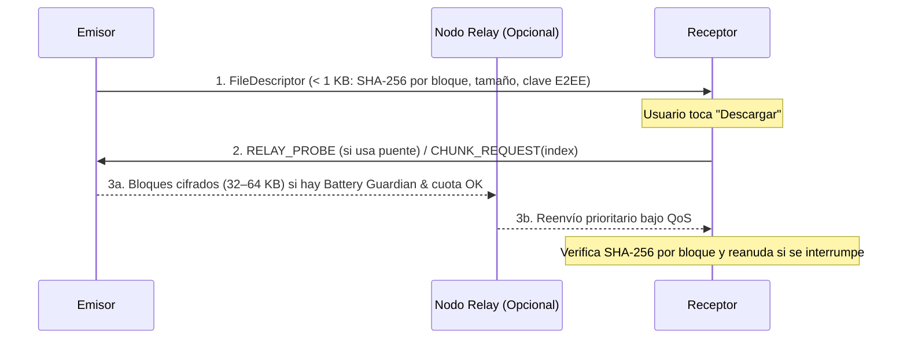

# Especificación de Red Mesh Offline y Transporte KMP

Este documento describe la arquitectura de red descentralizada de **Relay**, diseñada para mantener la mensajería privada, transferencias de archivos y llamadas de voz funcionando **sin conexión a internet ni infraestructura celular**.

---

## 1. Arquitectura de transporte desacoplada

La lógica de enrutamiento y cifrado vive en `commonMain` y opera sobre una abstracción agnóstica del medio físico (`MessageTransportMultiplexer`). A la capa de aplicación y a Room DB les resulta transparente si un paquete entró por Bluetooth LE, Wi-Fi Direct o un socket TCP/UDP en red local.

### Nodos Puente (*Bridge Nodes*)
Un dispositivo Android puede operar en modo **dual simultáneo**: conectado a una PC por red local (router Wi-Fi o Mobile Hotspot) y enlazado por **Nearby Connections** (Wi-Fi Direct / BLE) a otros teléfonos fuera del alcance del router. Si llega un paquete desde Desktop cuyo destinatario está en la malla inalámbrica, el nodo móvil puente reescribe el salto y lo retransmite hacia Nearby.

---

## 2. Detección del medio físico y *Bandwidth Upgrade* (BWU)

Google Play Services Nearby Connections expone la calidad de ancho de banda de forma genérica (`LOW`, `MEDIUM`, `HIGH`), sin indicar qué radio está transportando los bytes. Relay resuelve el medio físico real mediante una sonda híbrida en tres pasos:

1. **Inspección de interfaces de kernel (`NetworkInterface`):**
   - `p2p-wlan0-X` / `p2p0` → **Wi-Fi Direct**
   - `ap0` / `swlan0` / `softap0` → **Local-Only Hotspot / SoftAP**
   - `wlan0` (con enlace alto) → **Wi-Fi LAN**
2. **Validación activa por latencia (Micro-pings RTT):**
   - El multiplexor envía tramas de control `PING`/`PONG` con marca monotónica en nanosegundos.
   - **RTT < 10 ms:** Enlace Wi-Fi activo (apto para llamadas y archivos).
   - **RTT > 70–120 ms:** Tráfico degradado a **Bluetooth LE / Classic** (la interfaz degrada preventivamente funciones pesadas para evitar desconexiones).
3. **Hot-swapping (BWU):** El descubrimiento y handshake criptográfico (`UKEY2`) ocurren en BLE de bajo consumo; solo se levanta Wi-Fi Direct o Hotspot temporal cuando la topología o la transferencia lo justifican.

### Soporte de Mobile Hotspot (SoftAP) como anfitrión
Cuando un teléfono comparte su propio Mobile Hotspot, Android desactiva su estación `wlan0` y levanta interfaces SoftAP (`ap*`, `swlan*`, `softap*`, `rndis*`) fuera del radar estándar de `ConnectivityManager`. Para que el teléfono anfitrión descubra y reciba conexiones en ese modo:
- Se escanean interfaces RFC1918 activas directamente en el kernel.
- Los anuncios UDP (`47782`) se envían vinculados a la IP de cada interfaz hacia su broadcast de subred dirigido (evitando que el kernel los desvíe por datos móviles `rmnet`).
- El servidor TCP (`8080`) y UDP (`8081`) enlaza en `0.0.0.0`, y la UI separa visualmente subredes directas de nodos puenteados (`Relay · <Subred>`).

---

## 3. Enrutamiento Link-State + Gossip anti-tormentas

Para evitar colapsar el espectro inalámbrico y la batería en redes ad-hoc:

- **Deduplicación LRU:** Cada nodo mantiene una caché LRU con los `messageId` recientes; cualquier paquete repetido se descarta en silencio.
- **Límite estricto de saltos (TTL):** Máximo **3 a 4 saltos**. Si `TTL <= 0`, el paquete se descarta.
- **Dijkstra ponderado:** Cuando existen tablas de adyacencia Link-State, las rutas se calculan por costo físico:

| Interfaz física | Costo métrico | Motivo |
|---|:---:|---|
| **Ethernet / Wi-Fi LAN** | `1` | Máximo ancho de banda, mínima latencia y colisión. |
| **Nearby Wi-Fi Direct** | `3` | Alta velocidad con consumo moderado de radio. |
| **Nearby Bluetooth LE** | `8` | Ancho de banda muy limitado y alta latencia. |

- **Gossip con abanico controlado (*Fanout*):** Cuando no hay ruta directa conocida, en lugar de inundar a todos los vecinos (*flooding*), se selecciona un subconjunto aleatorio pequeño ($k = 2$ o $3$) con reparación local ante enlaces caídos.

---

## 4. Transferencia de archivos *Pull-Based*, QoS y *Battery Guardian*

Propagar archivos de varios megabytes por *Push* colapsaría los búferes Bluetooth. Relay divide el envío en dos planos:

### Salvaguardas de los nodos voluntarios (*Volunteer Relay*)
- **Battery Guardian:** Si la batería cae por debajo del umbral crítico (**20%–25%**), se suspende automáticamente el relevo de archivos pesados de terceros y solo se reenvía texto ligero. Opcionalmente puede restringirse a *"Solo mientras carga"*.
- **Cuota diaria de ancho de banda:** Límite configurable (por defecto 50–100 MB/día) y tope por archivo individual.
- **Probing Handshake (`RELAY_PROBE`):** Antes de usar un nodo intermedio para bloques grandes, se negocia capacidad (`RELAY_ACK` / `RELAY_NACK` por batería baja o cuota agotada).
- **Planificador QoS de dos colas:** El texto, confirmaciones (ACKs) y señalización siempre interrumpen y tienen prioridad estricta sobre fragmentos binarios de archivos.
- **Compresión previa al cifrado:** Imágenes (WebP) y audio (Opus) se comprimen **antes** de fragmentarse y cifrarse por bloque con AES-GCM.

---

## 5. Canal Público de la Malla

Relay incluye un canal de descubrimiento hiperlocal (`mesh_public_discovery`) con reglas estrictas para proteger la red:
- **Autenticidad sin cifrado oculto:** Los mensajes públicos viajan firmados digitalmente con la clave **Ed25519** del emisor para impedir suplantación.
- **Solo texto corto:** Límite de **140 a 280 caracteres** y **prohibición absoluta de archivos** para evitar tormentas de difusión.
- **Radio limitado:** TTL corto (2–3 saltos) y *rate limiting* (máximo 1 mensaje cada 3–5 segundos por clave pública).
